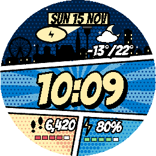
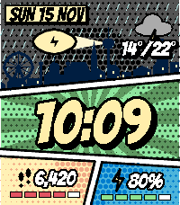

# Hero Signal

A superhero comic watchface for Pebble. The time is lettered big in a comic
panel full of speed lines and halftone dots. Above it, a hero signal shines over
the Vienna skyline (Riesenrad, Karlskirche, Stephansdom, DC Tower, with the
signal beaming out of the Donauturm) while your phone is connected. **When the connection drops, the
signal cuts out with a "KRZZT!" and the watch vibrates**, so you can't walk away
from your phone without noticing.

| Day | Night | Thunderstorm | Signal lost |
| :---: | :---: | :---: | :---: |
|  |  |  |  |

## Features

- **Phone connection at a glance:** the hero signal is on while the Pebble app
  is reachable. When the link drops it cuts out with a "KRZZT!" burst plus a
  vibration (switchable, and silent during Quiet Time). When the phone is back,
  the watch immediately asks for fresh weather.
- **Weather drawn into the sky:** sun, moon and stars, clouds, fog, rain, snow,
  sleet, hail, thunder and wind, each as its own scene, with a day and a night
  sky.
- **Outdoor weather** from the phone location via [Open-Meteo](https://open-meteo.com/)
  (no API key): icon, sky and temperature.
- **Plus a Home Assistant temperature**, shown next to it as `12°/21°`
  (outside / Home Assistant). Log in from the settings page (OAuth, no
  long-lived token to paste) and pick a `weather.*` entity or any temperature
  sensor, e.g. your living room. If Home Assistant's login page doesn't show
  up in the Pebble app, paste a long-lived access token instead (HA profile →
  Security → Long-lived access tokens).
- **Power meter:** today's steps against your goal; turns green when you hit it.
- **Energy meter:** battery level (the bolt turns green while charging).
- **Four hero colours:** red, blue, green, purple.
- Date in a comic caption box, German or English depending on the watch language.
- 12/24 h follows the watch setting; °C/°F in the settings.
- Readings older than 3 hours are hidden instead of pretending.

## Platforms

| Watch | Platform | Status |
| --- | --- | --- |
| Pebble Time 2 | `emery` (200×228) | primary target |
| Pebble Round 2 | `gabbro` (260×260, round) | primary target |
| Pebble Time / Time Steel | `basalt` (144×168) | works, layout is tight |
| Pebble Time Round | `chalk` (180×180, round) | works, layout is tight |

The black-and-white watches (Pebble 2 / 2 Duo, Classic) are not supported yet:
the face relies on colour.

## How it's built

- **Watch (C, `src/c/`):** everything is drawn procedurally, with no bitmaps.
  The Vienna landmarks in `scene.c` are small polygon drawings in
  screen-height-relative units. `comic.c` is a small comic toolkit: convex panels with polygon clipping
  (Sutherland–Hodgman), Ben-Day halftone, speed rays, sound-effect bursts and
  outlined lettering. `scene.c` lays out the page for rectangular and round
  screens of any size, and `main.c` holds the state and watch services.
- **Phone (TypeScript, `src/pkjs/`):** weather fetching, Home Assistant OAuth,
  and the settings page (`config.html`, bundled in as a string). The bundle is
  built with Bun.
- **Font:** [Bangers](https://github.com/googlefonts/bangers) (SIL OFL 1.1),
  compiled to Pebble fonts at a few sizes per platform.

### Older watches: stack and screen-edge gotchas

basalt/chalk firmware has a small app stack and does not clip shapes at the
screen edge. Both corrupted memory and hung the watch, so the code keeps
polygon buffers static, keeps the bigger draw helpers out of line
(`NOINLINE`), and clips every polygon and circle to the screen itself. Build
with `HERO_STACK_USAGE=1` to get per-function stack sizes (`build/**/*.su`).

## Development

Requires [Bun](https://bun.sh) (or `mise install`) and the Pebble SDK
(`pip install pebble-tool`, then `pebble sdk install 4.44`).

```sh
bun install
bun run build            # bundle the phone JS + build the .pbw
bun test                 # weather mapping + Home Assistant helper tests
bun run typecheck
bun run emulator:emery   # install in the emulator with logs
```

### Screenshot / demo mode

`HERO_DEMO="cond,night,disconnected,hero"` builds a fixed, fully populated
scene. The condition codes are in `src/c/scene.h`, and the hero colours are
0 red, 1 blue, 2 green and 3 purple.

```sh
HERO_DEMO=9,0,0,2 pebble build   # thunderstorm by day, green hero
HERO_DEMO=7,1,1,3 pebble build   # snowy night, phone disconnected, purple
```

### GitHub Pages (`docs/`)

The site is published from the `docs/` folder of `main`
(Settings → Pages → Deploy from a branch → `main` / `/docs`) at
<https://wendevlin.github.io/pebble-hero-signal-watchface/>.

| Path | Purpose |
| --- | --- |
| `docs/index.html` | Landing page and future documentation home. Also the Home Assistant OAuth `client_id`. |
| `docs/oauth/callback.html` | Home Assistant OAuth redirect: hands the login code back to the Pebble app via `pebblejs://close#…`. |
| `docs/screenshots/` | Screenshots used by the README and the site. |

Home Assistant identifies apps by a URL (`client_id`) and only redirects to the
same host, so both URLs live on this site (see `src/pkjs/ha.ts`). **Don't move
`docs/oauth/callback.html`**: its URL is compiled into every released `.pbw`.
Documentation can grow freely next to it. A test checks that the callback
exists where the app expects it.

The Home Assistant login only works once GitHub Pages is enabled.

### Phone permissions

Built with SDK 4.44, the app uses manifest v2: the Pebble app only lets
PebbleKit JS use what `usesPermissions` declares. Because Home Assistant can
live on any domain or on the local network, `Internet` is declared without a
domain list, together with `LocalNetwork` and `Location`.

## License

Code: [MIT](./LICENSE). Font: Bangers, [SIL Open Font License 1.1](./resources/fonts/OFL.txt).

The Home Assistant helpers and the settings-page approach are adapted from the
[Casita watchface](https://github.com/wendevlin/pebble-casita-watchface).
