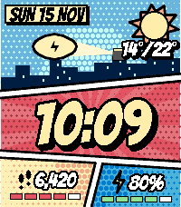
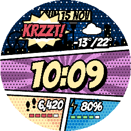

# Hero Signal

A superhero comic watchface for Pebble. A hero signal shines over the city
while your phone is connected. When the connection drops, it cuts out with a
**"KRZZT!"** and the watch vibrates.

| Day | Night | Thunderstorm | Signal lost |
| :---: | :---: | :---: | :---: |
|  |  |  |  |

## Features

- Hero signal shows the phone connection, with a vibration when it drops
- Weather drawn into the sky (phone location, via Open-Meteo)
- Optional Home Assistant temperature next to it: `12°/21°`
- Steps and battery meters
- Five cities: Vienna, New York, Paris, Gargoyle City, Quackville
- Four hero colours, °C/°F, 12/24 h, German or English date

For Pebble Time 2 and Round 2 (also runs on Pebble Time and Time Round).

## Development

See [DEVELOPMENT.md](./DEVELOPMENT.md).

## License

Code: [MIT](./LICENSE). Font: Bangers, [SIL OFL 1.1](./resources/fonts/OFL.txt).
